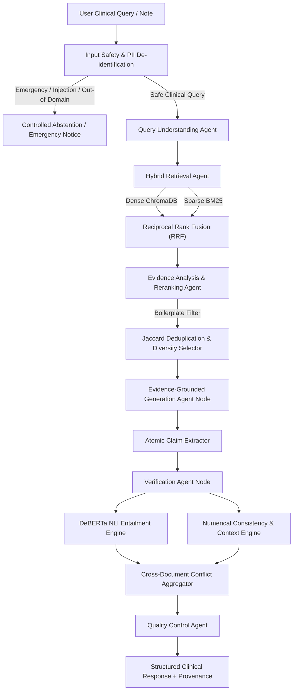

# ParmanaAI Architecture Specification

## 1. Executive Summary

**ParmanaAI** is an enterprise-grade clinical decision support and biomedical question-answering system engineered to eliminate clinical hallucinations in Large Language Model (LLM) outputs. Unlike conventional naive Retrieval-Augmented Generation (RAG) pipelines that rely solely on dense vector similarity and assume generated text is truthful, ParmanaAI enforces an end-to-end multi-agent verification graph incorporating:
1. **Hybrid Retrieval (Dense + BM25Okapi)** combined via Reciprocal Rank Fusion (RRF).
2. **Clinical Query Expansion & Entity Normalization** preventing terminology divergence.
3. **Cross-Encoder Reranking & Source Diversity Constraints** mitigating retrieval bias.
4. **Controlled Abstention & Safety Refusal Engine** halting hallucination on unanswerable, emergency, or off-topic queries.
5. **Atomic Claim Extraction & DeBERTa NLI Verification** assessing textual entailment.
6. **Numerical Consistency Engine & Clinical Context Matching** validating units, dosage thresholds, and physiological ranges.
7. **Cross-Document Conflict Resolution** identifying contradictory independent medical studies.

---

## 2. Multi-Agent Orchestration Architecture

---

## 3. Core Subsystems

### 3.1 Input Safety & HIPAA PII De-identification (`backend/safety/`)
- **HIPAA Safe Harbor Scrubber**: Detects and redacts Protected Health Information (PHI) including Social Security Numbers, Medical Record Numbers (MRNs), Dates of Birth (DOBs), patient names, and phone numbers before downstream LLM processing.
- **Triage & Emergency Detection**: Detects acute cardiovascular (chest pain radiating to arm), respiratory (severe dyspnea), and neurological (stroke FAST signs) symptoms, immediately routing to emergency protocols.
- **Prompt Injection Defense**: Filters system prompt extraction attempts, jailbreaks, and instructions override patterns.

### 3.2 Advanced Hybrid Retrieval (`backend/retrieval/`)
- **Dense Vector Search**: ChromaDB vector index embedded using `all-MiniLM-L6-v2`.
- **Sparse Lexical Search**: BM25Okapi with clinical tokenization preserving hyphenated drug formulations, units (`mg/dL`, `mmHg`), and medical acronyms (`T2DM`, `HTN`).
- **Reciprocal Rank Fusion (RRF)**:
  $$\text{RRF}(d) = \sum_{m \in \{\text{dense}, \text{sparse}\}} \frac{w_m}{k + \text{rank}_m(d)}$$
  Ensures that exact keyword matches and semantic matches reinforce one another.
- **Query-to-Evidence Relevance Guard**: Validates that retrieved evidence discusses the target clinical condition, discarding topic-divergent passages (e.g. discarding diabetes passages for hypertension queries).

### 3.3 Evidence Selection & Quality Reranking (`backend/reranking/`)
- **Quality Assessor**: Eliminates boilerplate headers, navigation snippets, and content with low medical information density.
- **Near-Duplicate Filter**: Deduplicates overlapping chunks using Jaccard word n-gram similarity (> 0.70 threshold).
- **Source Diversity Constraints**: Prevents a single document from monopolizing context by capping evidence to a maximum of 2 chunks per source document.

### 3.4 Atomic Claim Verification & Numerical Consistency (`backend/agents/`)
- **Compound Claim Splitting**: Breaks complex multi-clause sentences on coordinating conjunctions (`and`, `but`, `whereas`, `while`) into isolated atomic claims.
- **NLI Textual Entailment**: Evaluates premise-hypothesis alignment using fine-tuned DeBERTa NLI models, categorizing outputs into `entailment`, `neutral`, and `contradiction`.
- **Unit Normalization & Decimal Arithmetic**: Normalizes mass (`mcg`, `mg`, `g`, `kg`), volume (`ml`, `l`), pressure (`mmHg`), and percentages using lossless `Decimal` math.
- **Clinical Context Matching**: Ensures comparison occurs across identical analytes (e.g., fasting blood glucose vs postprandial glucose) and patient cohorts (pediatric vs adult).
- **Conflict Resolution**: Discrepancies between independent peer-reviewed sources are classified as `cross_document_conflict` and highlighted to clinicians rather than arbitrarily averaged.

### 3.5 Database & Observability (`backend/database/`, `backend/observability/`)
- **Atomic Persistence**: SQLite with WAL journal mode storing queries, individual atomic claims, and retrieved evidence records.
- **Structured JSON Logging**: Trace ID and Request ID correlation with automated PII redaction.
- **Real-Time Diagnostics**: In-memory Prometheus-compatible metrics registry tracking latency percentiles (p50, p95, p99), refusal rates, and average hallucination scores.
